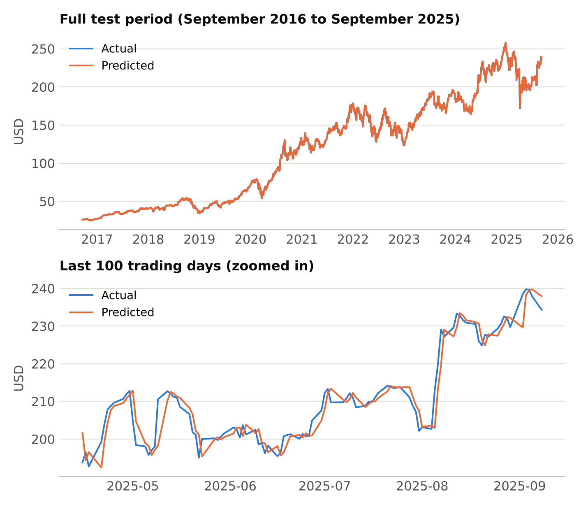
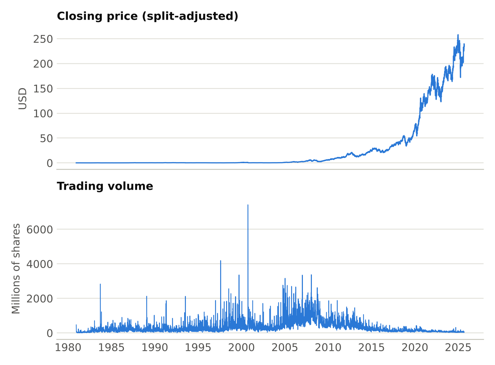

<h1 align="center">📈 Apple Stock Price Prediction</h1>

<p align="center">
  Predicting Apple's next-day closing price from historical data<br>
  <b>Arch Technologies · Data Science Internship · Task 2</b>
</p>

<p align="center">
  
  
  
  
  
</p>

---

## 📌 Overview

This project builds a **supervised regression** model that predicts Apple's closing stock price for the next trading day from the current day's open, high, low, close and volume.

The Kaggle dataset covers **11,276 trading days** (December 1980 to September 2025). The data has no ready-made answer column, so the target was created from the history: for each day, the target is the *following day's* closing price. The data was split **by time** (never shuffled) so the model is tested only on days that come after the ones it learned from.

**Key finding**
- ✅ On the test period (Sep 2016 to Sep 2025) the model's average error was **$1.50** and its **R² was 0.9987**.
- ⚠️ A naive baseline that simply predicts "tomorrow's close = today's close" scored **almost exactly the same**. The model tracks the price very closely, but it adds almost nothing beyond repeating the current price.

## 📊 Results

Evaluated on 2,255 test days that the model never saw during training.

| Measure | Naive baseline | Linear Regression | Meaning |
| --- | --- | --- | --- |
| **MAE** | 1.5003 | 1.4988 | Average error in USD |
| **RMSE** | 2.4078 | 2.4019 | Error, larger misses weighted more |
| **R²** | 0.9987 | 0.9987 | Share of price variation explained |

- Training R²: **0.9996**
- Average test price: **$116.45**, so a $1.50 average error is about **1.3%** of the price.

### Actual vs predicted prices

<p align="center">
  
</p>

Over the full test period the two lines overlap almost completely. In the zoomed view of the last 100 days, the predicted line follows the actual line **about one day late**: the model reacts to a price move only after it has happened.

### How to read these numbers

- **A high R² does not prove skill here.** Prices change slowly from day to day and vary enormously over nine years, so even a method that does nothing scores 0.9987. This is why the baseline comparison matters.
- **The model is essentially tied with the baseline** (MAE $1.4988 vs $1.5003). A 0.1% difference is not meaningful.
- **The model follows the trend but cannot call turning points.** Today's open, high, low and volume add almost no information about tomorrow's move.

## 🔎 Exploratory Data Analysis

<p align="center">
  
</p>

- Prices are **split-adjusted**, which is why the earliest prices are around $0.10.
- The price stays near zero for years, then climbs steeply to a high of about **$258 in December 2024**. It changes by a factor of more than a thousand over the period, so the series is not stable over time. This matters because the model is trained on one period and tested on a very different one.
- Trading volume peaked around September 2000 and has fallen since.

**Data quality checks**

| Check | Result |
| --- | --- |
| Rows and columns | 11,276 rows, 6 columns |
| Date range | 12 Dec 1980 to 9 Sep 2025 |
| Missing values | None in any column |
| Duplicate dates | 0 |
| Days with zero volume | 1 (a quirk of the source, no effect on the model) |

## 🧹 Preprocessing

| Step | What was done | Why |
| --- | --- | --- |
| Create the target | `Target = Close.shift(-1)` | The task is to predict a future price, so each row needs the future price as its answer |
| Remove the last row | Dropped the final day | It has no next day, so its target is missing |
| Choose features | `Open`, `High`, `Low`, `Close`, `Volume` | The inputs named in the task; `Date` is not a feature |
| Split by time | First 80% train, last 20% test, `shuffle=False` | A random split would let the model learn from days after the ones it is tested on |
| Scale the features | `StandardScaler` fitted on the training data only | Volume (hundreds of millions) and prices (tens of dollars) are on very different scales; fitting on training data avoids leaking the future |

| | Days | Period | Price range |
| --- | --- | --- | --- |
| **Train** | 9,020 | Dec 1980 to Sep 2016 | $0.04 to $29.65 |
| **Test** | 2,255 | Sep 2016 to Sep 2025 | $24.39 to $258.10 |

The test prices go far above anything the model saw while learning. This is the main limitation of the project.

## 🤖 Model

**Linear Regression** (scikit-learn). It predicts tomorrow's close as a weighted sum of today's five values plus a constant. It was chosen because it is simple, fast and easy to explain. The largest weight was on today's **Close**, with small adjustments from High, Low and Open, and almost zero weight on Volume. In other words, the model learned that *tomorrow's price is close to today's close*.

## 📁 Project Structure

```
stock-price-prediction/
├── data/
│   └── README.md                      # How to download the Kaggle dataset
├── images/                            # Charts used in this README
├── notebooks/
│   └── Stock_Price_Prediction.ipynb   # Full analysis with outputs
├── src/
│   └── stock_price_prediction.py      # End-to-end pipeline script
├── requirements.txt
├── LICENSE
└── README.md
```

## 🚀 Getting Started

```bash
git clone https://github.com/AreejSimab/stock-price-prediction.git
cd stock-price-prediction
pip install -r requirements.txt

# Download the dataset (see data/README.md), then run either:
jupyter notebook notebooks/Stock_Price_Prediction.ipynb
python src/stock_price_prediction.py
```

## ⚠️ Limitations

- Test prices (up to $258) are far above training prices (up to about $30), so the model must predict outside the range it learned from.
- Only the day's own price and volume were used. News, earnings and market events, which drive real price moves, are not in the data.
- One model and one time split were used, and the test score covers a single historical period.

## 🔮 Future Improvements

- [ ] Add lagged and moving-average features so the model sees recent history, not a single day.
- [ ] Predict the **daily return** (percentage change) instead of the raw price, which removes the problem of changing price levels.
- [ ] Train and test on more recent years only, so training and test prices are in a similar range.
- [ ] Try an **LSTM** model, which is designed for sequences of days.

## 🛠️ Tech Stack

Python · pandas · NumPy · matplotlib · seaborn · scikit-learn · Jupyter

## 📚 Dataset

[Apple Stock Price History](https://www.kaggle.com/datasets/shamimhasan8/apple-stock-price-history-dataset) (Kaggle): 11,276 daily rows, 12 Dec 1980 to 9 Sep 2025.

> ⚠️ This project is for learning only and is **not financial advice**.

## 👤 Author

**Areej Simab**
Data Science Intern

- GitHub: [@AreejSimab](https://github.com/AreejSimab)
- LinkedIn: www.linkedin.com/in/areej-simab-3718502a3

## 📄 License

Released under the [MIT License](LICENSE).
